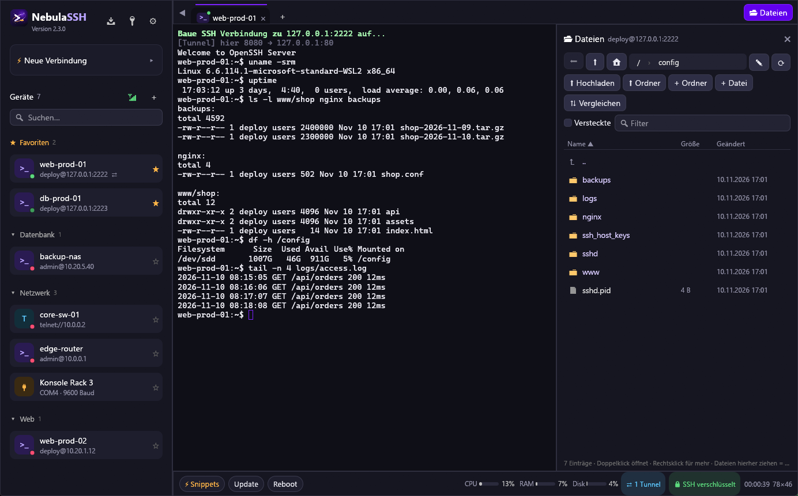
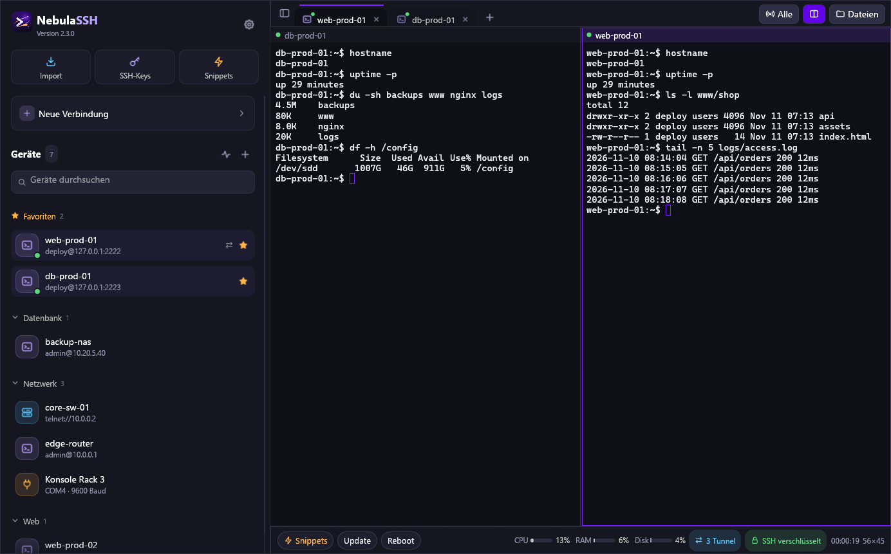
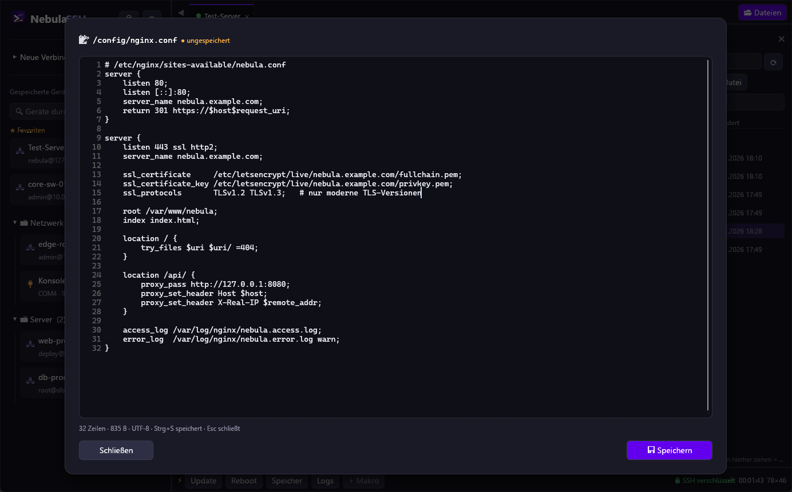
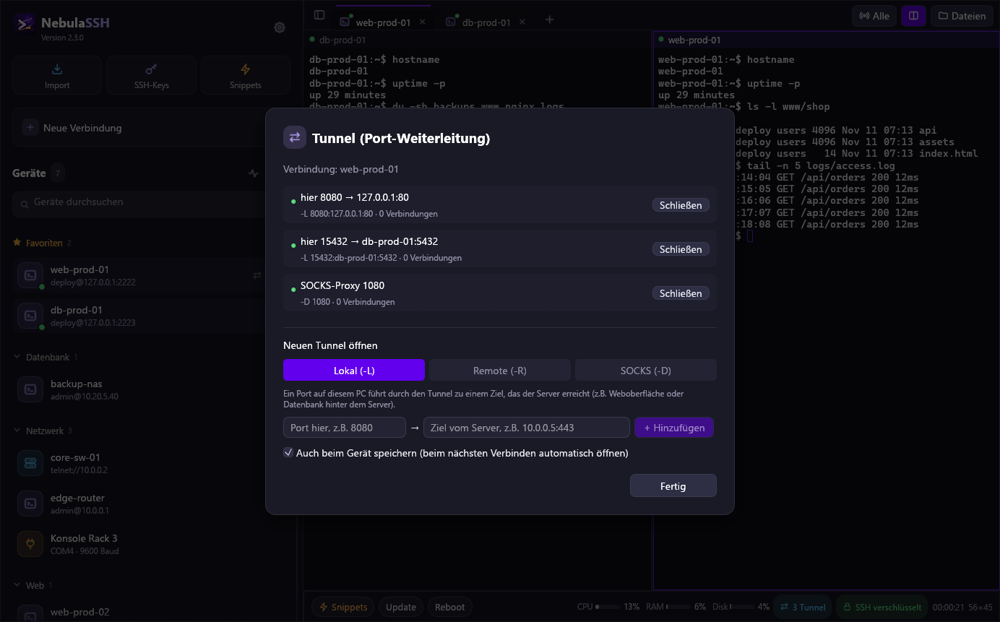
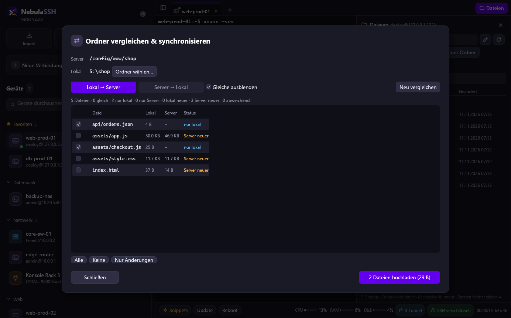
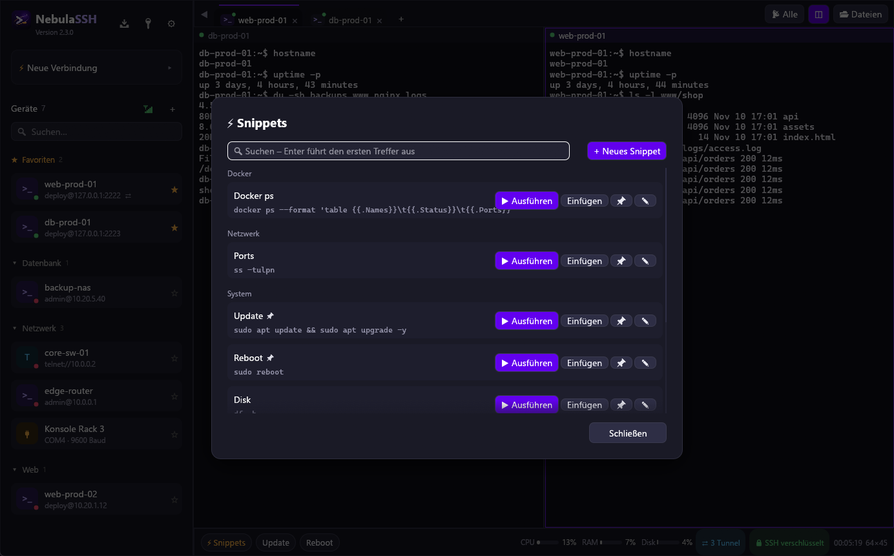
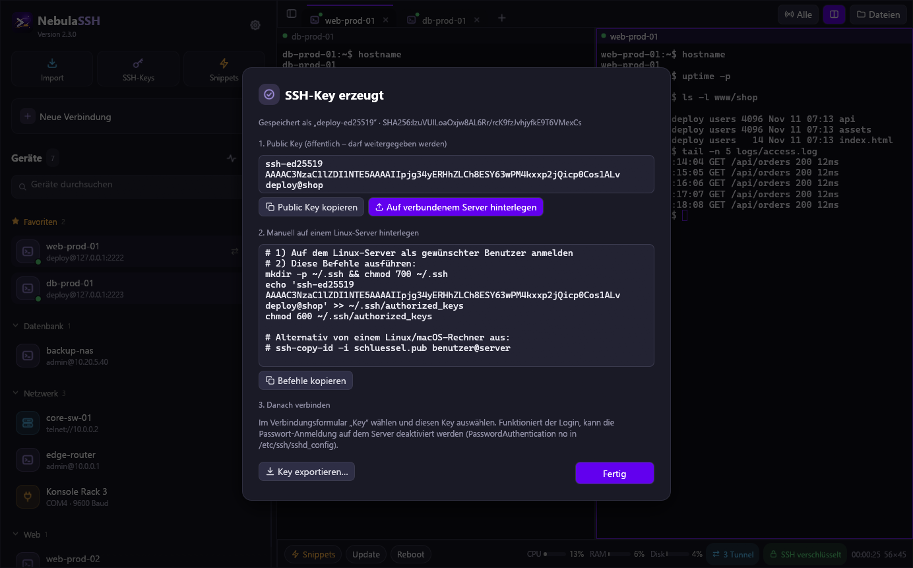

<p align="center">
  
</p>

<h1 align="center">NebulaSSH</h1>

<p align="center">
  <b>Kostenloser SSH-, SFTP-, Telnet- und Serial-Client für Windows</b><br>
  Die moderne Alternative zu PuTTY, MobaXterm und WinSCP – nativ in Rust, ohne Browser im Hintergrund.
</p>

<p align="center">
  <a href="https://github.com/Zenutrix/NebulaSSH/releases/latest"></a>
  <a href="https://github.com/Zenutrix/NebulaSSH/releases"></a>
  
  
  
</p>

<p align="center">
  <a href="https://github.com/Zenutrix/NebulaSSH/releases/latest/download/NebulaSSH-Setup.exe"><b>Installer herunterladen</b></a> ·
  <a href="https://github.com/Zenutrix/NebulaSSH/releases/latest/download/NebulaSSH-portable.exe">Portable Version</a> ·
  <a href="https://schoepf-tirol.at/Project/NebulaSSH/">Website</a> ·
  <a href="#english">English</a>
</p>

<p align="center">
  
</p>

## Was ist NebulaSSH?

NebulaSSH verbindet dich mit **Servern, Switches, Routern und seriellen Konsolen** – per SSH, SFTP, Telnet oder COM-Port, alles in einem Fenster mit Tabs. Die App läuft direkt auf deinem PC: kein Konto, kein Cloud-Dienst, keine Werbung. Geräte, Passwörter und Keys bleiben AES-256-verschlüsselt auf deinem Rechner.

- **4,6 MB Installer**, keine Laufzeitumgebung nötig (kein WebView2, kein .NET)
- **Rund 150 MB Arbeitsspeicher** im Leerlauf, ein einziger Prozess
- **Oberfläche auf Deutsch und Englisch**
- **Signierte automatische Updates**

## Funktionen

<table>
  <tr>
    <td width="50%"></td>
    <td width="50%"></td>
  </tr>
  <tr>
    <td><b>Geteilte Ansicht</b><br>Bis zu vier Terminals nebeneinander, Tabs per Ziehen in ein eigenes Fenster.</td>
    <td><b>Dateien &amp; Editor</b><br>SFTP-Explorer mit Drag &amp; Drop. Doppelklick öffnet die Datei, Strg+S speichert auf dem Server.</td>
  </tr>
  <tr>
    <td></td>
    <td></td>
  </tr>
  <tr>
    <td><b>Tunnel &amp; Jump-Host</b><br>Port-Weiterleitung lokal (-L), remote (-R) und SOCKS (-D), pro Gerät gespeichert. ProxyJump über eine Bastion.</td>
    <td><b>Ordner abgleichen</b><br>Lokalen Ordner mit dem Server vergleichen und nur Neues und Geändertes übertragen.</td>
  </tr>
  <tr>
    <td></td>
    <td></td>
  </tr>
  <tr>
    <td><b>Snippets</b><br>Häufige Befehle mit Platzhaltern, in Gruppen und mit Suche (Strg+Umschalt+P).</td>
    <td><b>SSH-Keys</b><br>Ed25519, RSA oder ECDSA erzeugen und mit einem Klick auf dem Server hinterlegen.</td>
  </tr>
</table>

**Außerdem:**

- SSH mit Host-Key-Prüfung, Passwort, Key oder SSH-Agent (Pageant, Windows-OpenSSH-Agent, 1Password, KeePassXC), Agent- und X11-Weiterleitung
- Telnet für ältere Switches und Router, serielle Konsole über COM-Port mit eigenen Baudrate-Profilen
- Import aus **PuTTY**, **MobaXterm** und `~/.ssh/config`
- Broadcast: ein Befehl an alle offenen Tabs gleichzeitig
- CPU, RAM und Festplatte des Servers in der Statusleiste; Wake-on-LAN, Ping und Port-Prüfung
- Verschlüsselte Ablage, App-Sperre (Argon2id), verschlüsseltes Backup für den Umzug auf einen neuen PC

## NebulaSSH im Vergleich

| Funktion | NebulaSSH | PuTTY | MobaXterm |
|---|:---:|:---:|:---:|
| SSH-Terminal mit Tabs | ✓ | – | ✓ |
| SFTP-Explorer mit Editor | ✓ | nur psftp | ✓ |
| Lokale Ordner mit dem Server abgleichen | ✓ | – | – |
| Tunnel (-L, -R, SOCKS) pro Gerät speichern | ✓ | ✓ | ✓ |
| Jump-Host (ProxyJump) | ✓ | – | ✓ |
| Telnet und serielle Konsole | ✓ | ✓ | ✓ |
| Bis zu vier Terminals nebeneinander | ✓ | – | ✓ |
| Import aus PuTTY und MobaXterm | ✓ | – | nur PuTTY |
| Ohne Limit bei Sitzungen und Tunneln | ✓ | ✓ | Home-Edition begrenzt |
| Oberfläche auf Deutsch | ✓ | – | – |

## Installation

1. [Installer herunterladen](https://github.com/Zenutrix/NebulaSSH/releases/latest/download/NebulaSSH-Setup.exe) und starten – oder die [portable EXE](https://github.com/Zenutrix/NebulaSSH/releases/latest/download/NebulaSSH-portable.exe) für den USB-Stick verwenden.
2. Links eine Verbindung eingeben und speichern – oder Sitzungen aus PuTTY oder MobaXterm importieren.

Voraussetzung: Windows 10 oder 11, 64 Bit. Prüfsummen stehen in [`SHA256SUMS.txt`](https://github.com/Zenutrix/NebulaSSH/releases/latest/download/SHA256SUMS.txt) beim jeweiligen Release.

<a id="english"></a>
## English

**NebulaSSH is a free SSH, SFTP, Telnet and serial client for Windows 10 and 11** – a modern alternative to PuTTY, MobaXterm and WinSCP, written natively in Rust with no browser running underneath. It runs entirely on your PC: no account, no cloud service, no ads.

- Tabbed SSH terminal with split view (up to four terminals) and detachable windows
- SFTP file browser with built-in editor, drag & drop and folder sync
- Port forwarding (-L, -R, SOCKS), jump hosts, SSH agent (Pageant, OpenSSH, 1Password, KeePassXC), X11 forwarding
- Telnet and serial console (COM port), broadcast to all tabs
- Imports sessions from PuTTY, MobaXterm and `~/.ssh/config`
- Encrypted storage, app lock, encrypted backup, signed automatic updates
- Interface in English and German (follows the Windows display language)

[Download the installer](https://github.com/Zenutrix/NebulaSSH/releases/latest/download/NebulaSSH-Setup.exe) · [Portable EXE](https://github.com/Zenutrix/NebulaSSH/releases/latest/download/NebulaSSH-portable.exe) · [Website in English](https://schoepf-tirol.at/Project/NebulaSSH/en/)

---

# Für Entwickler

## Projektstruktur

| Ordner | Inhalt |
|---|---|
| `core/` | Kern-Bibliothek: SSH inkl. Tunnel/Jump/Agent/X11 (`ssh.rs`), Telnet (`telnet.rs`), Serial (`serial.rs`), Import (`import.rs`), Server-Kennzahlen (`stats.rs`), Wake-on-LAN/Ping (`net.rs`), Sprache (`i18n.rs`), verschlüsselte Ablage (`storage.rs`), SSH-Key-Generator (`keys.rs`), Backup & App-Sperre (`backup.rs`) |
| `native/` | Die Windows-App (egui + alacritty_terminal): `app.rs` (Logik, geteilte Ansicht, eigene Fenster), `terminal.rs`, `sidebar.rs`, `files.rs` (SFTP-Explorer, Warteschlange), `sync.rs`, `importer.rs`, `snippets.rs` (Snippets, Tunnel-Dialog), `dialogs.rs`, `theme.rs` |
| `branding/` | Logo (`logo.svg`) und Installer-Grafiken; `cargo run -p brand` erzeugt daraus `branding/out/` |
| `installer/` | NSIS-Skript (`nebulassh.nsi`) und Build-Skript (`build.ps1`) |
| `website/` | Produkt-Website mit echten Screenshots und Downloads |
| `legacy-go/`, `legacy-tauri/` | Ältere Versionen (Go/Wails 1.x, Tauri 2.0) zum Nachschlagen |

## Bauen

Voraussetzungen: Rust (MSVC-Toolchain), NSIS (wird unter `%LOCALAPPDATA%\tauri\NSIS` oder `Programme\NSIS` gesucht).

```powershell
powershell -ExecutionPolicy Bypass -File installer\build.ps1
```

Ergebnis in `dist/`:
- `NebulaSSH-Setup-<version>.exe` – Installer (installiert nach `C:\Program Files\NebulaSSH`, Startmenü, optional Desktop, Eintrag in „Apps & Features“)
- `NebulaSSH-<version>-portable.exe` – einzelne EXE

Nur die App: `cargo build -p nebulassh --release` → `target/release/nebulassh.exe`

## Updates über GitHub-Releases

Die App sucht beim Start unter
`https://github.com/Zenutrix/NebulaSSH/releases/latest/download/update.json` nach einer neuen Version
(Repository steht in `installer/github-repo.txt`). Ein Update wird nur installiert, wenn diese Datei mit dem
geheimen Signierschlüssel (Ed25519) signiert ist und die heruntergeladene Datei die signierte SHA-256-Prüfsumme hat.
Installierte Versionen starten den Installer still (`/S /RELAUNCH`, mit UAC-Abfrage), die portable Version ersetzt sich selbst.

- **Geheimer Signierschlüssel:** `%USERPROFILE%\.nebulassh-release\update-signing.key` – liegt bewusst außerhalb des Projekts und wird **nie** hochgeladen. **Unbedingt sichern!** Ohne ihn kann keine installierte Version mehr Updates erhalten.
- **Öffentlicher Schlüssel:** `native/update_public_key.txt` (wird in die App eingebaut)

### Neue Version veröffentlichen

1. Version in `native/Cargo.toml` erhöhen, Änderungen in `installer/release-notes.txt` eintragen.
2. Bauen:
   ```powershell
   powershell -ExecutionPolicy Bypass -File installer\build.ps1
   ```
3. Auf GitHub ein neues Release mit dem Tag `v<version>` (z.B. `v2.3.2`, **mit „v“ vorne**) anlegen und **alle Dateien aus `dist\github-release\`** hochladen:
   `NebulaSSH-Setup-<version>.exe`, `NebulaSSH-<version>-portable.exe`, `NebulaSSH-Setup.exe`, `NebulaSSH-portable.exe`, `update.json`, `SHA256SUMS.txt`.
   Das Release muss als **Latest** markiert sein (kein Entwurf, keine Vorabversion).

Alternativ automatisch per Token (GitHub → Settings → Developer settings → Fine-grained token, nur dieses Repository, „Contents: Read and write“):
```powershell
$env:GITHUB_TOKEN = "<Token>"
powershell -ExecutionPolicy Bypass -File installer\build.ps1 -Publish
```

Die Website verlinkt auf `…/releases/latest/download/NebulaSSH-Setup.exe` und zeigt damit immer die neueste Version.
Sicherheitsupdates: `cargo run -p release -- manifest <version> <url> <notizen> --critical` öffnet den Update-Dialog sofort beim Start.

## Tests

```bash
cargo test                       # Unit-Tests (Kern + App)
# Integrationstests gegen einen echten SSH-Server, z.B.:
# docker run -d -p 127.0.0.1:2222:2222 -e PASSWORD_ACCESS=true -e USER_NAME=nebula -e USER_PASSWORD=nebulatest lscr.io/linuxserver/openssh-server
# (für Tunnel-Tests: -e DOCKER_MODS=linuxserver/mods:openssh-server-ssh-tunnel)
NEBULA_TEST_SSH="127.0.0.1:2222|nebula|nebulatest" cargo test -p nebula-core -- --ignored --test-threads=1
```

## Daten

- **Installiert:** `%APPDATA%\NebulaSSH` – **Portable:** neben der EXE (falls beschreibbar)
- `hosts.json`, `keys.json`, `sessions.json`: AES-256-GCM-verschlüsselt, Schlüssel in der Windows-Anmeldeinformationsverwaltung (`NebulaSSH:encryption_key`, kompatibel zu 1.x)
- `settings.json` (Einstellungen, Snippets), `known_hosts.json` (Host-Fingerprints), `logs/` (optional)
- Umzug auf einen neuen PC: Einstellungen → Daten & Backup → Backup erstellen (`.nebula`, Argon2id + AES-256-GCM)

## Tastenkürzel

| Kürzel | Aktion |
|---|---|
| Strg+Umschalt+T | Neue Verbindung |
| Strg+Tab / Strg+Umschalt+Tab | Tab wechseln |
| Strg+Umschalt+W | Tab schließen |
| Strg+Umschalt+D | Tab duplizieren |
| Strg+Umschalt+R | Neu verbinden |
| Strg+Umschalt+E | Datei-Explorer |
| Strg+Umschalt+B | Seitenleiste ein/aus |
| Strg+Umschalt+P | Snippets (Befehlsbibliothek) |
| Strg+Umschalt+S | Geteilte Ansicht ein/aus |
| Strg+Umschalt+O | Tab in eigenem Fenster |
| Strg+F | Im Terminal suchen |
| Strg + / − / 0 | Schriftgröße |
| Umschalt+Bild↑/↓, Umschalt+Pos1/Ende | Im Verlauf scrollen |

---

NebulaSSH von Thomas Schöpf · [Website](https://schoepf-tirol.at/Project/NebulaSSH/) · [Releases](https://github.com/Zenutrix/NebulaSSH/releases)
